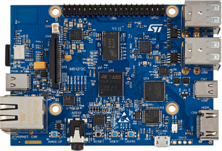
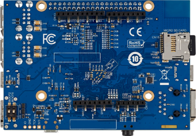
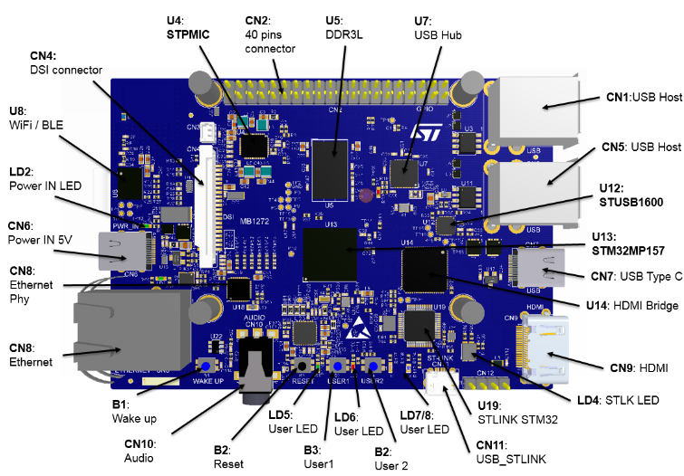

# mp157-dk1-prj

Application repository for the STM32MP157A-DK1 discovery board running
OpenSTLinux 6.6-yocto-scarthgap-mpu-v26.06.10 (st-image-weston).

## Board

STM32MP157A-DK1 discovery kit (MB1272 board):

Connector close-ups live in [board_images/](board_images/) (DSI, HDMI, Ethernet,
TF card, USB host, Arduino, audio jack, GPIO connector, boot switches, LCD
daughter board).

Expansion connector pinouts: [docs/expansion-connectors.md](docs/expansion-connectors.md)

## Usage

- Source `env.sh` (WSL) to load the cross toolchain, then `make` inside an app
  directory; each app has its own README with details
- `make deploy` transfers the built binary to the board
  (rsync if the board has it, tar-over-ssh otherwise)
- User LEDs LD5/LD6/LD7 are available to applications; LD8 is the kernel
  heartbeat

## Applications

- [apps/blink_hello](apps/blink_hello) — blinks LD5/LD6/LD7, samples DTS temperature + ADC channels
- [apps/coremark](apps/coremark) — EEMBC CoreMark, ARM vs Thumb-2 builds and scores
- [apps/record-play](apps/record-play) — interactive audio record (30 s / S-key) and playback, loops
- [apps/netbench](apps/netbench) — TCP throughput benchmark for GbE and USB NCM gadget
- [apps/ssd1317_md066_64x48_iic](apps/ssd1317_md066_64x48_iic) — SSD1317 64x48 OLED on I2C5 (CN2), demo port from f425-start
- [apps/blink_check](apps/blink_check) — CN2 wire-continuity blinker + pin-state probe (bring-up diagnostics)
- [apps/a7_m4_hello](apps/a7_m4_hello) — A7↔M4 rpmsg hello: vendored CubeMP1 subset M4 firmware + A7 manager
- [apps/coremark_m4_209m](apps/coremark_m4_209m) — CoreMark 1.0.1 on the Cortex-M4 @ 208.9 MHz, results via rpmsg trace
- [apps/mini_gui](apps/mini_gui) — GTK mini GUI: embedded UVC camera (gtksink) + internal sensor plots
